# Awesome Cloud Infrastructure & Self-Hosted PaaS 🚀

  

  
  
  
  
  
  

---

## 🌟 Top Cloud Infrastructure & Self-Hosted PaaS Ecosystem

> **A Curated, SEO-Optimized List of Enterprise SaaS Platforms & Production-Ready Open-Source GitHub Projects**  
> *Targeted at Self-Hosted Platform-as-a-Service (PaaS), Git-Push Deployments, Docker & Kubernetes Orchestration, Zero-Downtime Microservices, and Developer Cloud Infrastructure.*  
> 📅 **Last updated: November 2026**

This repository serves as a definitive index tracking notable **SaaS/hosted developer cloud platforms** and **open-source self-hosted alternatives**. Whether you are an indie hacker deploying side projects, a DevOps platform engineer orchestrating bare-metal VPS clusters, or a startup modernizing infrastructure away from hyperscaler bills, these tools provide automated Git-push deployments, Nixpacks/Buildpacks image generation, dynamic reverse proxying with automatic SSL, and zero-downtime container management.

---

## 📑 Table of Contents

- [📊 Sector Overview & Market Dynamics](#-sector-overview--market-dynamics)
- [☁️ SaaS / Hosted Platforms](#️-saas--hosted-platforms)
- [🛠️ Open-Source GitHub Projects (Ranked by Stars)](#️-open-source-github-projects-ranked-by-stars)
- [🧩 Infrastructure Building Blocks & Toolchains](#-infrastructure-building-blocks--toolchains)
- [🤝 How to Contribute](#-how-to-contribute)
- [💖 Support & Share](#-support--share)
- [📈 Star History](#-star-history)
- [⚠️ Disclaimer](#️-disclaimer)

---

## 📊 Sector Overview & Market Dynamics

The global Platform-as-a-Service (PaaS) market is estimated at approximately **$133B–$196B in 2026**, expanding at an aggressive Compound Annual Growth Rate (CAGR) of **~15%–21%**, propelled by containerization, serverless adoption, and GPU-intensive AI workloads. 

The industry demonstrates a distinct **barbell market structure**:
1. **High Concentration at the Hyperscale Core:** Foundational cloud infrastructure is dominated by hyperscalers (AWS, Microsoft Azure, Google Cloud Platform) and enterprise cloud leaders like Salesforce, capturing the vast majority of enterprise spend and cloud credits.
2. **Dynamic Fragmentation at the Developer Layer:** The application and developer-experience (DX) tier remains **moderately fragmented**. Independent developer clouds (Render, Railway, Fly.io) and self-hosted open-source platforms (Coolify, Dokploy, Kamal, Dokku) compete rapidly on DX, developer ergonomics, fast cold starts, edge microVM execution, transparent flat pricing, and sovereign self-hosting freedom.

---

## ☁️ SaaS / Hosted Platforms

| Platform | Valuation / Company Scale | Starting Tier Pricing | Free Tier / Trial Limits | Description |
| :--- | :--- | :--- | :--- | :--- |
| **[Heroku (Salesforce)](https://heroku.com)** | **$260B–$320B+** *(Parent Salesforce NYSE: CRM market cap; FY25 revenue ~$37.9B)* | **$5.00/month** (Eco dyno plan; $0.007/hr billed usage) | **No permanent free tier**; entry Eco pool provides **1,000 shared dyno hours/month** across personal apps (sleeps after 30 min inactivity; 512MB RAM cap). Basic always-on dynos start at $7/mo. | ⚡ Pioneering cloud Platform-as-a-Service (PaaS) offering Git-based deployments, Buildpacks, managed Postgres/Redis add-ons, and simple horizontal dyno scaling. |
| **[DigitalOcean App Platform](https://digitalocean.com)** | **~$4.4B–$5.2B+** *(NYSE: DOCN market cap; FY25 revenue ~$901M)* | **$5.00/month** (Basic Shared CPU: 1 vCPU, 512MB RAM, 50GB transfer) | **Free forever plan** limited strictly to **static sites**: up to **3 static apps**, 1 GiB/month outbound data transfer, global CDN, and automated SSL (no container/database execution). | 🌊 Managed PaaS built on DigitalOcean infrastructure enabling automated builds and deployments directly from GitHub/GitLab repositories and container registries. |
| **[Render](https://render.com)** | **$1.5B** valuation *(Series C unicorn; $258M total funding)* | **$7.00/month** (Individual Starter web service: 512MB RAM, 1 CPU, always-on) | **Free forever plan**: **750 instance hours/month** for web services (512MB RAM, spins down after 15 min idle, 30–60s cold start), free static site hosting, and 1GB Postgres (expires after 30 days). | 🚀 Unified cloud application platform offering managed web services, static sites, cron jobs, private networking, and zero-downtime deployments via `render.yaml`. |
| **[Railway](https://railway.com)** | **Growth-stage** *(~$120M total funding; $100M Series B)* | **$5.00/month** (Hobby plan base fee; includes $5 usage credits, always-on execution, and custom domains) | **Free forever plan** with **$1/month recurring usage credit**, 1 project (up to 3 services, 0.5GB RAM & 1 vCPU each, sleeps after 5–10 min inactivity; no custom domains). New accounts receive a **30-day trial with a one-time $5 credit**. | 🛤️ Modern developer cloud PaaS featuring instant Git-push deployments, visual service canvases, built-in PostgreSQL/Redis databases, and usage-based infrastructure scaling. |
| **[Fly.io](https://fly.io)** | **~$100M–$467M** valuation *(~$110.5M total funding; Series C)* | **$2.19/month** (Micro VM: `shared-cpu-1x` 256MB RAM run 24/7; usage-based per second) | **7-day free trial** with **$1 starter credit** (no credit card required; up to 10 machines, 4GB RAM max, auto-stops after 5 min idle). Post-trial: **$0 bill waiver** for personal orgs whose total monthly usage is under $5. | 🪰 Edge-first cloud application platform running Docker containers inside lightweight Firecracker microVMs close to users across global regions. |
| **[Northflank](https://northflank.com)** | **~$120M** estimated valuation *(~$24.9M total funding; Series A)* | **$2.70/month** (Micro container: 0.1 shared vCPU, 256MB RAM; pay-as-you-go) | **Free Developer Sandbox plan** (always-on): up to **2 running services**, **2 scheduled jobs**, **1 managed database addon** (PostgreSQL/Redis/MongoDB), and 1 BYOC cluster. | 🛡️ Full-stack cloud deployment platform uniting multi-cloud Kubernetes orchestration, CI/CD builds, preview environments, and managed databases. |
| **[Porter Cloud](https://porter.run)** | **Series A startup** *(~$21.5M total funding; $20M Series A)* | **$19.00/month baseline** ($13/mo per vCPU + $6/mo per GB RAM, prorated per minute + cloud provider cost) | **No permanent free tier or standalone trial credit pool**; operates on metered compute while deploying directly into the user's AWS/GCP/Azure account (utilizes user's underlying cloud credits). | 📦 Managed PaaS running directly inside your own AWS, GCP, or Azure account, combining a Heroku-like developer experience with underlying Kubernetes scalability. |
| **[Koyeb](https://koyeb.com)** | **Subsidiary of Mistral AI** *(Acquired Feb 2026; previously raised $8.6M; Mistral AI valued at $13.8B)* | **$29.00/month** (Pro plan base fee; includes $10 compute credit, NVMe storage, and priority builds) | **Free forever plan**: **1 web service** (512MB RAM, 0.1 vCPU, 2GB SSD, sleeps after 1 hour idle; Frankfurt/Washington DC) and **1 PostgreSQL database** (1GB storage, 5 hours active compute/month). | 🌐 Developer-friendly serverless PaaS providing global edge deployment, auto-scaling, native GPU instances, and Git-driven container execution. |
| **[Coolify Cloud](https://coolify.io)** | **Bootstrapped / Open-Source** *(~$380k ARR / ~$32k MRR from cloud subscriptions & sponsorships)* | **$5.00/month** (Base cloud control plane; connects and orchestrates up to 2 external VPS servers) | **No free hosted cloud control plane** ($5/mo starting), but the underlying self-hosted open-source software is **100% free forever** on your own VPS with zero artificial feature limitations. | 🔮 Official managed control-plane hosting for Coolify, allowing teams to connect and manage their own VPS servers without maintaining the Coolify dashboard instance. |

---

## 🛠️ Open-Source GitHub Projects (Ranked by Stars)

All open-source alternatives are sorted strictly in descending order by GitHub stargazers count:

1. **[Caddy (`caddyserver/caddy`)](https://github.com/caddyserver/caddy)**   
   ⚡ Powerful, enterprise-ready, open-source HTTP/2 and HTTP/3 web server with automatic HTTPS issuance and renewals via Let's Encrypt and ZeroSSL, ideal as an edge PaaS gateway.

2. **[Coolify (`coollabsio/coolify`)](https://github.com/coollabsio/coolify)**   
   🔮 The flagship open-source, self-hostable Heroku/Netlify/Vercel alternative. Deploys applications, databases, and over 280+ one-click community services to any server or VPS via SSH with Nixpacks and Docker Compose support.

3. **[Traefik (`traefik/traefik`)](https://github.com/traefik/traefik)**   
   🚦 Modern HTTP reverse proxy and ingress controller designed for microservices with dynamic configuration and native Docker/Swarm/Kubernetes auto-discovery.

4. **[Portainer (`portainer/portainer`)](https://github.com/portainer/portainer)**   
   🚢 Universal container management UI and deployment platform for Docker, Docker Swarm, and Kubernetes environments across homelabs and enterprise clouds.

5. **[Dokploy (`Dokploy/dokploy`)](https://github.com/Dokploy/dokploy)**   
   🚀 Next-generation open-source PaaS built on Docker Swarm and Traefik. Supports multi-server cluster orchestration, Git auto-deployments, Nixpacks/Dockerfile builds, and real-time container metrics.

6. **[Dokku (`dokku/dokku`)](https://github.com/dokku/dokku)**   
   📦 Battle-tested, lightweight single-host mini-Heroku powered by Docker that turns any Debian/Ubuntu machine into an efficient `git push` application deployment platform.

7. **[OpenFaaS (`openfaas/faas`)](https://github.com/openfaas/faas)**   
   ⚡ Open-source Serverless Functions and microservices platform for Docker and Kubernetes with auto-scaling to zero and any-language support.

8. **[Rancher (`rancher/rancher`)](https://github.com/rancher/rancher)**   
   🤠 Complete software stack for teams adopting containers and managing multiple Kubernetes clusters across any bare-metal or cloud infrastructure.

9. **[CapRover (`caprover/caprover`)](https://github.com/caprover/caprover)**   
   ⛵ User-friendly, lightweight open-source PaaS and server manager powered by Docker, Nginx, and automated SSL for one-click app and database deployments.

10. **[Kamal (`basecamp/kamal`)](https://github.com/basecamp/kamal)**   
    🎯 Zero-downtime containerized application deployment CLI tool engineered by 37signals, orchestrating web services, accessory containers, and Kamal Proxy on bare metal and cloud VMs.

11. **[Komodo (`moghtech/komodo`)](https://github.com/moghtech/komodo)**   
    🦎 Resource-efficient, self-hosted deployment engine and multi-server manager featuring Git webhook auto-deploys, Docker Compose management, and server alerting.

12. **[Piku (`piku/piku`)](https://github.com/piku/piku)**   
    🥧 The smallest, fastest `git push` PaaS inspired by Dokku. Operates with zero Docker overhead, deploying Python, Node.js, Go, and Ruby apps on low-spec VPS and Raspberry Pi boards.

13. **[Tsuru (`tsuru/tsuru`)](https://github.com/tsuru/tsuru)**   
    🕊️ Extensible open-source Platform as a Service that orchestrates Docker containers across Kubernetes clusters with autoscaling, routing, and developer-centric workflows.

14. **[Kubero (`kubero-dev/kubero`)](https://github.com/kubero-dev/kubero)**   
    ☸️ Fully open-source Heroku-compatible PaaS built natively on Kubernetes, featuring GitOps continuous delivery, review apps, and multi-language buildpack integrations.

15. **[Nixpacks (`railwayapp/nixpacks`)](https://github.com/railwayapp/nixpacks)**   
    ❄️ Lightweight, high-performance container build engine that analyzes application repositories and generates reproducible OCI container images without requiring a Dockerfile.

16. **[YunoHost (`YunoHost/yunohost`)](https://github.com/YunoHost/yunohost)**   
    🏠 Debian-based self-hosting operating system automating server administration, DNS configuration, Let's Encrypt certificates, email hosting, and single sign-on (SSO).

17. **[Cozystack (`cozystack/cozystack`)](https://github.com/cozystack/cozystack)**   
    ☁️ Free, turn-key open-source PaaS and private cloud platform built on Talos Linux and Kubernetes for running managed databases, virtual machines, and tenant K8s clusters on bare metal.

18. **[Infradeck (`karlo-ks/Infradeck`)](https://github.com/karlo-ks/Infradeck)**   
    🖥️ Modern open-source PaaS management dashboard and cloud infrastructure orchestration panel engineered for container deployments and server monitoring.

---

## 🧩 Infrastructure Building Blocks & Toolchains

* 🛠️ **Build & Image Generation:** [Nixpacks](https://github.com/railwayapp/nixpacks) and [Paketo Cloud-Native Buildpacks](https://buildpacks.io) provide zero-configuration Docker image building directly from source code.
* 🚦 **Reverse Proxies & Ingress:** [Caddy](https://caddyserver.com) and [Traefik](https://traefik.io) deliver production-grade automatic TLS, Let's Encrypt certificates, and dynamic route discovery for Docker containers.
* 🖥️ **Multi-Host Orchestration:** [Portainer](https://portainer.io) and [Komodo](https://github.com/moghtech/komodo) simplify fleet-wide Docker Compose synchronization and multi-node cluster deployments.
* 💡 **Turnkey Homelab Platforms:** [YunoHost](https://yunohost.org) and [Cloudron](https://cloudron.io) manage DNS, automated backups, and integrated SSO for self-hosted productivity suites.

---

## 🤝 How to Contribute

Contributions to this ecosystem list are warmly welcomed! 

1. 🍴 **Fork** this repository.
2. 📝 **Add or update** entries in `README.md` following the existing markdown format and star-ranking order.
3. 🔍 **Verify details**: Include project name, official GitHub repository link, factual descriptions, and clear pricing/free-tier constraints.
4. 🚀 **Submit a Pull Request** with a descriptive summary of your changes.

---

## 💖 Support & Share

If you find this curated PaaS and cloud infrastructure guide valuable, your support means the world! 🌟

- ⭐ **Star this repository** to bookmark it and help other developers and DevOps engineers find it.
- 🍴 **Fork & Share** with your engineering team, tech communities, and colleagues on [X / Twitter](https://twitter.com), [LinkedIn](https://linkedin.com), and Reddit.
- ☕ **Buy me a coffee / Sponsor**: If this project saved you hours of research or infrastructure costs, consider buying me a coffee or supporting ongoing open-source curation on the [GitHub Sponsor Dashboard](https://github.com/sponsors/ishandutta2007). Your sponsorship helps keep these guides thoroughly verified, updated, and ad-free!

  

---

## 📈 Star History

---

## ⚠️ Disclaimer

- 📋 This is an independent, community-driven resource list — entries do not imply paid endorsement.
- 🔒 Self-hosting infrastructure in production requires appropriate SSH key authentication, robust firewall configuration (UFW / security groups), encrypted automated off-site backups (S3 / Backblaze B2), and regular OS security patches.
- 🧪 Always validate staging deployments, health check probes, and data persistence before migrating critical production workloads to self-hosted PaaS environments.

---

  <b>Built with ❤️ for indie hackers, DevOps/platform engineers, homelab hobbyists, and open-source cloud innovators.</b> 
  Empowering developers to own their infrastructure, cut cloud bills, and deploy anywhere.

